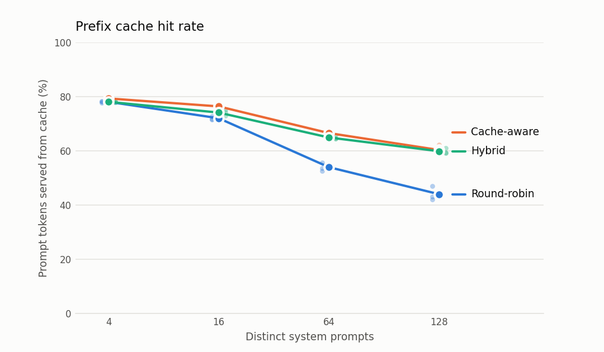
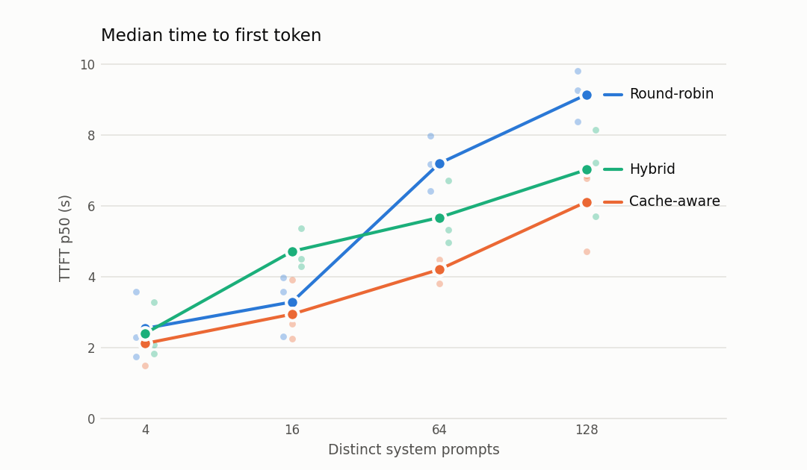

# vllm-prefix-router

Prefix-cache-aware request routing for multi-replica vLLM on Kubernetes.

Once the system prompts no longer fit in one replica's cache, routing requests by prompt prefix served up to 16 points more prompt tokens from cache than round-robin, and cut median time to first token by up to 42%. [Details below.](#results)

## The problem

vLLM caches the KV state of prompt prefixes it has already processed (automatic prefix caching). When a new request shares a prefix with an earlier one, such as the same system prompt or an earlier turn of the same conversation, vLLM skips recomputing it. On a single replica this is a large win. In a quick test on this setup, a ~2.3k-token prompt took 12.4s cold and 0.32s when its prefix was cached.

With several replicas behind a standard load balancer, that benefit mostly disappears.

- **Repeated misses.** A prefix misses once on *every* replica instead of once overall.
- **Duplicated cache.** Each replica caches the same popular prefixes, so the cluster's effective cache capacity is divided by the number of replicas, and prefixes get evicted sooner.

Routing every request to the replica that holds its prefix fixes this, but it creates hotspots. If one prefix is very popular, a pure cache-affinity router sends all of it to one replica while the others sit idle.

I chose this problem because getting vLLM running on Kubernetes is mostly configuration work. Deciding where each request should go is a real systems tradeoff between cache reuse and load balance, and it can be measured.

## Approach

A router sits in front of the vLLM replicas and compares three policies.

| Policy | Behavior |
|---|---|
| Round-robin | Baseline. Ignores the request content. |
| Cache-aware | Sends each request to the replica with the longest matching prefix. |
| Hybrid | Cache-aware, but falls back to the least-loaded replica when the preferred one's in-flight request count exceeds the least-loaded one's by more than a threshold. |

I used round-robin as the baseline because it is what a standard Kubernetes Service effectively does. All three policies run inside the same router, so measured differences come from the policy rather than from the network path. The experiments measure how much cache hit rate and time-to-first-token improve over round-robin as the number of distinct system prompts, and so the cache pressure, grows.

I did not test more than 2 replicas, tuning the hybrid thresholds, and workloads dominated by one very popular prompt (the hotspot case the hybrid policy is designed for).

## Results

**When the set of distinct system prompts is larger than one replica's cache, cache-aware routing serves 13–16 percentage points more prompt tokens from cache than round-robin, and cuts median time to first token by 33–42%.** When every prompt fits in each replica's cache, the policies perform about the same.

The workload is multi-turn chat on 2 replicas, with about 0.8 new sessions per second for 2 minutes, 3 turns per session, and a ~420-token system prompt drawn from N distinct prompts. Each configuration was run 3 times. Lines show the mean, and the faint dots show the individual runs.

I held think time and reply length fixed and varied the number of distinct system prompts, because that controls cache pressure directly. I capped replies at 8 tokens because CPU decoding is slow enough to swamp the prefill time that routing affects. I report hit rate as well as latency because it measures the mechanism directly, and it doesn't drift with host speed the way latency did between sessions.





| System prompts | Policy | Cache hit rate | TTFT p50 | TTFT p95 |
|---|---|---|---|---|
| 4 | Round-robin | 78.0% | 2.54s | 5.07s |
| 4 | Cache-aware | 79.3% | 2.11s | 4.05s |
| 4 | Hybrid | 78.0% | 2.40s | 4.96s |
| 16 | Round-robin | 72.0% | 3.29s | 6.96s |
| 16 | Cache-aware | 76.3% | 2.94s | 5.68s |
| 16 | Hybrid | 74.0% | 4.72s | 11.12s |
| 64 | Round-robin | 53.9% | 7.20s | 14.80s |
| 64 | Cache-aware | **66.5%** | **4.20s** | **8.74s** |
| 64 | Hybrid | 64.9% | 5.67s | 12.66s |
| 128 | Round-robin | 43.9% | 9.14s | 21.65s |
| 128 | Cache-aware | **60.2%** | **6.12s** | 14.11s |
| 128 | Hybrid | 59.8% | 7.02s | **13.26s** |

These are means of 3 runs. The per-run ranges are in [`results/final-summary.md`](results/final-summary.md), and the tail-latency chart is [`results/figures/final-ttft-p95.png`](results/figures/final-ttft-p95.png).

**What the results show**

- **The benefit comes from not duplicating the cache.** Round-robin eventually stores every system prompt on both replicas, so together they hold no more distinct prompts than one replica does. Cache-aware routing splits the prompts between the replicas, which roughly doubles the effective cache size. With 4 or 16 prompts (about 2k–7k tokens), everything fits in each replica's ~43k-token cache anyway, and the policies tie. At 64 and 128 prompts it no longer fits, and the hit-rate gap opens to +12.6 points at 64 and +16.3 at 128.
- **Hit rate is the most stable measurement.** Repeated runs agree within 1–5 points, and an earlier single-repeat experiment (`exp3`) gave nearly the same values. Latency moved by up to 1.5–2x between sessions on the same host, so compare latencies within this table, not across experiments.
- **The hybrid policy did not pay off here.** Its hit rate is close to cache-aware's, but its median latency was higher at 16 and 64 prompts in every run. The likely cause is that it sends a request away from its cached replica when there is a momentary load imbalance, and so pays for a full prefill. This has not been confirmed. The workload has no single dominant prompt, which is the hotspot case the hybrid policy is designed for, so this setup does not test where it should help.

**Caveats.** These runs used a CPU only, a 0.5B model, 2 replicas, and 3 runs per configuration.

**A lesson from the benchmarking.** My first experiment made the hybrid policy look much worse under heavy load. When I re-ran it with the policy order reversed, whichever policy ran last in a block was slowest, regardless of which policy it was. After that, I rotated the order and paused between runs. The full experiment log is in [`results/NOTES.md`](results/NOTES.md).

## Setup

Runs locally on [kind](https://kind.sigs.k8s.io/) on an Apple Silicon Mac (CPU only), with Docker Desktop given ~12GB of memory.

I ran this on a laptop rather than on rented GPUs to keep the cost at zero and to make every experiment easy to rerun. The routing question doesn't depend on the hardware, since duplicated prefixes waste cache whether that cache lives in CPU or GPU memory, and hit rate measures that directly. On a CPU, prefill is slow, so a cache miss costs more and the latency gaps are probably wider than they would be on a GPU. The hit-rate results should carry over more closely than the absolute latencies.

| Component | Choice |
|---|---|
| Cluster | kind, single node |
| Inference server | `vllm/vllm-openai-cpu:v0.31.0-arm64` |
| Model | Qwen2.5-0.5B-Instruct |
| Replicas | 2 |

```bash
mkdir -p hf-cache
kind create cluster --config kind-config.yaml
kind load docker-image vllm/vllm-openai-cpu:v0.31.0-arm64 --name vllm
kubectl apply -f vllm-deployment.yaml -f vllm-service.yaml
kubectl rollout status deployment/vllm

# Router
docker build -t vllm-router:dev router/
kind load docker-image vllm-router:dev --name vllm
kubectl apply -f router-deployment.yaml
kubectl port-forward svc/router 8080:8080   # then send OpenAI-style requests to localhost:8080
```

The routing policy is set with the `POLICY` environment variable in `router-deployment.yaml` (`round_robin`, `cache_aware`, or `hybrid`). The cache-aware policy matches prompts in chained-hash chunks of `CHUNK_CHARS` characters (default 128) and remembers about one replica's KV cache worth of chunks per replica (`CHUNKS_PER_BACKEND`). The hybrid policy leaves the cached replica only when its in-flight count exceeds the least-busy replica's by at least `MIN_GAP` requests (default 4) and by at least a factor of `MIN_RATIO` (default 1.5).

The router adds an `x-routed-to` response header naming the replica that served each request, and `GET /stats` shows the current replicas, in-flight counts, and routing table size.

### Running experiments

The load generator (`loadgen/`) simulates chat users and runs inside the cluster as a Kubernetes Job. I ran it in the cluster because `kubectl port-forward` hung under concurrent load. New sessions arrive at a fixed average rate (a Poisson process), regardless of how fast the system responds, so overload shows up as rising latency rather than as reduced load. Within a session, each turn waits for the previous reply and resends the whole conversation, which produces the multi-turn prefix reuse the router targets. Each run warms up every replica first, and it puts a fresh run ID into its system prompts so that prefixes cached by earlier runs can't produce hits.

```bash
docker build -t vllm-loadgen:dev loadgen/
kind load docker-image vllm-loadgen:dev --name vllm

# ./run-experiment.sh <policy> <name> [VAR=value ...]
./run-experiment.sh cache_aware shared-4 SESSION_RATE=0.3 N_SYSTEM_PROMPTS=4 TURNS=3
```

The script restarts the router with the chosen policy, so every run starts with an empty routing table, and writes one CSV row per request to `results/<name>-<policy>.csv`. Each row records the session, turn, prompt length, the replica that served it, time-to-first-token, and total latency. The workload is controlled by `SESSION_RATE`, `DURATION`, `N_SYSTEM_PROMPTS`, `SYSTEM_PROMPT_CHARS`, `TURNS`, `USER_MSG_CHARS`, `THINK_TIME`, and `MAX_TOKENS`.

### Notes on running vLLM on CPU in Kubernetes

These settings were needed to fit two replicas in ~12GB. Each is explained in `vllm-deployment.yaml`.

- **Image version.** `v0.32.0-arm64` crashes on the first request on arm64 CPU, so the image is pinned to `v0.31.0`.
- **Shared memory.** vLLM needs more than the container default of 64MB of `/dev/shm`, so a memory-backed `emptyDir` is mounted there.
- **Thread count.** `OMP_NUM_THREADS` must match the CPU limit. Otherwise vLLM sizes its thread pool to the host's cores and gets throttled by the cgroup CPU quota.
- **No compilation.** `--enforce-eager` skips torch.compile, whose startup memory peak exceeds the per-pod limit.
- **Single process.** `--distributed-executor-backend=uni` runs the model in the engine process rather than a separate worker process, which saves ~1.5GB per pod.
- **Small KV cache.** `--kv-cache-memory-bytes` is set to 512MB (about 43k tokens).
- **Recreate strategy.** A rolling update would briefly need a third pod, which doesn't fit.

Measured memory is ~4.6GiB per pod.
